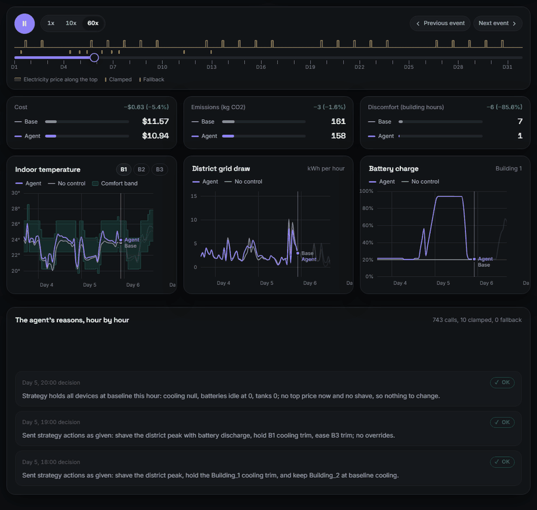
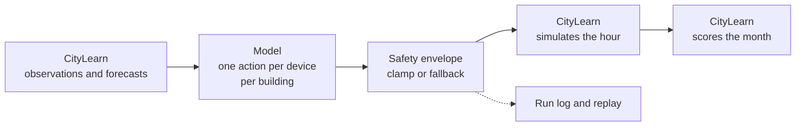

# Hyperbolic

**A month of building ops in an hour.**

[](https://github.com/AddisonTech/Hyperbolic/actions/workflows/ci.yml)
[](LICENSE)
[](CHANGELOG.md)
[](https://addisontech.github.io/Hyperbolic/)

Claude makes the hourly supervisory calls on cooling, batteries and hot water for a simulated district in [CityLearn](https://github.com/citylearn-project/CityLearn), and a deterministic safety envelope checks every move before it reaches the building. Every result is scored by CityLearn's own KPI evaluation.

## A small model with the engineering beat a big model without it.


With no rules, Haiku cut cost by 0.7 percent and Sonnet by 5.4 percent. With the strategy's rules in words, Haiku cut it by 7.2 percent. With the rules computed in code and handed over as an action, Haiku cut it by 8.0 percent, level with the scripted strategy's 8.0 percent.

This is one tuning month, one run per prompt, on a month the strategy's numbers were chosen on; the numbers come from `hyperbolic months` and the recorded runs ([0.14.0](docs/HISTORY.md#version-0140-blind-mode), [0.15.0](docs/HISTORY.md#version-0150-rules-in-words)).

## Holdout

Mean of three months (June, July and August, 2,205 hours) on Buildings 4, 5 and 6 of `citylearn_challenge_2023_phase_3_1`, which nothing was tuned on, scored once:

| CityLearn KPI (district) | baseline | 0.4.0 rule-based | Haiku v9 |
|---|---|---|---|
| cost_total | 1.0000 | 0.9731 | **0.9231** |
| carbon_emissions_total | 1.0000 | 0.9984 | **0.9544** |
| discomfort_proportion | 0.1294 | 0.1296 | **0.0279** |
| all_time_peak_average | 1.0000 | 0.9933 | **0.8902** |

Haiku v9 beats the baseline and the rule-based controller on every KPI in every month (unserved energy in outages tied at 0), and it stays within 0.0006 of its own scripted strategy without beating it overall: it is slightly behind on mean cost, emissions and the all-time peak. Every month and KPI: [docs/HOLDOUT_RESULTS.md](docs/HOLDOUT_RESULTS.md).

## Watch it run



The live viewer replays the 0.15.0 Haiku v9 run on tuning July against the no-control baseline, hour by hour: [addisontech.github.io/Hyperbolic](https://addisontech.github.io/Hyperbolic/). To run one live on your own machine, see [Watch it live](docs/DESIGN.md#watch-it-live).

## How it works



### Why it is built this way

- **Deterministic code does the safety work.** The model never acts on the simulator directly. Plain Python checks every value against hard limits first.
- **The model only makes the supervisory call.** One action per device per building, once an hour. Everything below that is CityLearn's physics.
- **Every decision is logged and replayable.** Each run folder holds the full request, the raw reply, tokens, cost, every clamp and fallback with its reason, and every simulator state and outcome. `hyperbolic replay` re-runs the whole thing with zero model calls and zero simulator calls and checks it reproduces exactly.
- **Results are graded honestly.** KPIs come from `CityLearnEnv.evaluate()` on an official challenge dataset. The viewer states a loss as plainly as a win.
- **Nothing outside the machine.** Version 0.1.0 targeted the hosted BOPTEST service, which stopped starting tests. CityLearn runs locally and the dataset ships with the repository, so a run needs no server and no download.

## How this was tested

- **Pass or fail rules committed before the runs.** The acceptance rule or readings for 0.11.0, 0.13.0, 0.14.0 and 0.15.0 were written into the [CHANGELOG](CHANGELOG.md) and committed before the runs they judge.
- **Holdout sealed and scored once.** Its files are pinned by sha256 in [HOLDOUT.md](HOLDOUT.md), the tools refuse it without `--holdout-final`, and it was scored once, in 0.12.0.
- **Every hour replays exactly with zero model calls.** `hyperbolic replay` re-runs a recorded run from its files with no model or simulator calls and fails if any decision or action differs.
- **Total API spend for 0.13.0 to 0.15.0: $11.9488**, the sum of the nine recorded runs' costs ($11.948801), under the $15.00 cap. The release notes round each run first and give $11.9487.

## Run it

Python 3.10, 3.11 or 3.12 (CityLearn 3.0.2 needs numpy below 2, which has no Python 3.13 wheels).

CityLearn is installed with `--no-deps`. Its published pins (scikit-learn 1.2.2, openstudio, torchvision, doe_xstock) are only needed by optional features and would force a source build on Python 3.12. Hyperbolic's own dependencies are the packages CityLearn's simulation core imports.

### Windows (PowerShell, with a virtual environment)

```powershell
cd C:\path\to\Hyperbolic
py -3.12 -m venv .venv
.\.venv\Scripts\python -m pip install --no-deps CityLearn==3.0.2
.\.venv\Scripts\python -m pip install -e ".[dev]"
.\.venv\Scripts\python -m pytest -q

.\.venv\Scripts\python -m hyperbolic run --scripted --hours 24   # 24 hour dry run of the rule-based controller, no API calls
.\.venv\Scripts\python -m hyperbolic run --model haiku --budget 2.00   # key from HYPERBOLIC_ANTHROPIC_KEY or TRIAGE_ANTHROPIC_KEY
.\.venv\Scripts\python -m hyperbolic compare     # KPI table, rebuilds docs\data\viewer.json and viewer.js
```

### macOS or Linux

```bash
python -m pip install --no-deps CityLearn==3.0.2
python -m pip install -e ".[dev]"
export HYPERBOLIC_ANTHROPIC_KEY="your key"
python -m hyperbolic run && python -m hyperbolic compare
```

### Commands

| Command | What it does |
|---|---|
| `hyperbolic baseline` | Runs CityLearn's no-control reference. `--month` as for `run`. |
| `hyperbolic run` | Runs the supervisor through the envelope. `--model sonnet`, `--budget 5`, `--hours 24` for a short run, `--month tuning-06`, `tuning-07` or `tuning-08` for a month of the tuning set instead of the phase 2 month (`phase2`, the default), `--scripted` for the 0.4.0 rule-based controller with no API calls (prompt version 3 and the 0.4.0 envelope), `--scripted --prompt-version 4` or `5` for the version 4 or 5 strategy executed literally, `--scripted --prompt-version 6` for the version 5 strategy with the 0.8.0 trim hold, `--scripted --prompt-version 7`, `8` or `9` for the version 7, 8 or 9 strategy kept inside the envelope's ranges, `--inject-faults` with `--scripted` to exercise clamps and fallback, `--prompt-version 1` to `8` for the 0.2.0, 0.3.0, 0.4.0, 0.6.0, 0.7.0, 0.8.0, 0.9.0 or 0.10.0 prompt. `--month holdout-06`, `holdout-07` or `holdout-08` records a run on the sealed holdout without printing its KPIs (see [HOLDOUT.md](HOLDOUT.md)). Runs of two days or more need hours + 1 to be a whole number of days (for example 167 or 719), a limit of CityLearn 3.0.2's outage model. |
| `hyperbolic months` | Runs the baseline, the 0.4.0 rule-based controller and the scripted v7, v8 and v9 strategies on every month of the month set (the phase 2 month and the three tuning months), in parallel with no model calls, and prints each KPI per month and the mean. `--controllers`, `--months`, `--run RUN` (repeatable) to show a finished run at the month it was recorded on, `--out` for JSON. `--holdout-final --months holdout-06 holdout-07 holdout-08` is the one final scoring of the sealed holdout, on its own; without the flag a holdout month or run is refused. |
| `hyperbolic replay RUN_DIR` | Re-runs a saved run from its files with zero model or simulator calls and reports whether every decision and action matches. Exit code 1 if not. |
| `hyperbolic compare` | Pairs the latest baseline (from `runs/` or the committed `results/`) with the latest agent run (a live run wins over a scripted one), prints the KPIs and writes the viewer data. `--pair BASELINE AGENT` to choose, `--out` to write the viewer data elsewhere, `--against RUN` (repeatable) to print another finished run of the same length beside them, for example the rule-based controller; the viewer data is unchanged. A pair on the holdout is refused without `--holdout-final`. |
| `hyperbolic serve` | Live mode in the browser on 127.0.0.1 (see [Watch it live](docs/DESIGN.md#watch-it-live)). `--port 8765`, `--no-browser`. |

`python -m hyperbolic` works the same as `hyperbolic`. A full episode simulates in about 7 seconds; a live run takes as long as 719 model calls.

## Limits

- **Simulator only.** Beating CityLearn's reference is evidence worth investigating, not proof of field savings.
- **The reference is a modest bar.** No storage use and an ideal-load heat pump; any sensible battery schedule should beat it on cost.
- **On the holdout the agent adds nothing measurable over its strategy.** Haiku v9 is within 0.0006 of v9 scripted on every KPI and slightly behind it on mean cost, emissions and the all-time peak.
- **The experiments ran on one tuning month, with single runs.** 0.13.0 to 0.15.0 ran on tuning July, a month the strategy was tuned on, which favors it, and run-to-run spread was not measured.
- **Hourly supervision only.** One decision per hour, three devices per building.

Every limit, with what each experiment does and does not show: [docs/LIMITS.md](docs/LIMITS.md).

## More

- [docs/HISTORY.md](docs/HISTORY.md): every release's results, from the first live run that tied the baseline.
- [docs/DESIGN.md](docs/DESIGN.md): the dataset, the baseline, what the agent sees, tuning, the safety envelope, model access and budget, the viewers and the tests.
- [HOLDOUT.md](HOLDOUT.md): the sealed holdout and its hashes.
- [CHANGELOG.md](CHANGELOG.md): every release, with each rule as it was committed before its runs.

**This is a simulator project.** Nothing here connects to a real building, BAS, or customer system.

## Credits and license

MIT, see `LICENSE`.

CityLearn is developed by the Intelligent Environments Laboratory and contributors and is distributed under the MIT license. The dataset in `hyperbolic/data/citylearn_challenge_2023_phase_2_local_evaluation` is copied unchanged from the CityLearn repository (tag v3.0.2); its license is in `hyperbolic/data/CITYLEARN_LICENSE.txt`. The tuning dataset in `scripts/tuning_data/citylearn_challenge_2023_phase_2_online_evaluation_1` and the holdout dataset in `holdout/citylearn_challenge_2023_phase_3_1` are copied unchanged from the same repository and tag, under the same license. Hyperbolic is not affiliated with the CityLearn project.
